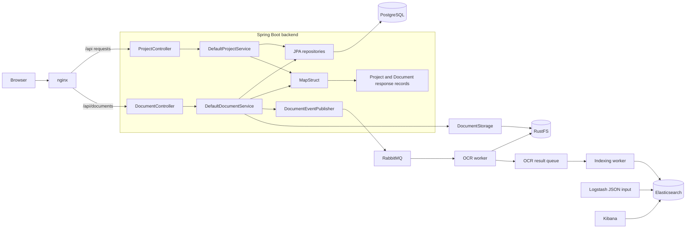

# SWEN3 Document Management System

Software Engineering 3 Labor, WS 2026, Group G
Yann Polini and Simon Stangelberger

[Repository](https://github.com/SimSta123/SWEN-3-Document-Management-System) | [Kanban board](https://github.com/users/YannPolini/projects/4) | [Milestones](https://github.com/SimSta123/SWEN-3-Document-Management-System/milestones)

This is our document management system for SWEN3. We can save document titles, list them on a dashboard and open their details. We can upload PDFs through the website or API, store them in RustFS and extract their text in the OCR worker. Our additional use case is organising documents into projects. Each document belongs to one project at a time, and assigning it to another project moves it there.

We are adding Sprint 4 on top of the Sprint 3 work. PDFs are stored in RustFS, our replacement for the slide's MinIO. The OCR worker fetches stored PDFs and extracts their text with Tesseract. The indexing worker stores that text in Elasticsearch. Website search is the next step.

## How our project works

We use HTML, CSS and JavaScript for the website, nginx for the web server, Java 25 with Spring Boot 4.1.1 for the backend, and PostgreSQL 17 for storage. We build the backend with Maven.



When we save a title or upload a PDF, the request goes through nginx to `DocumentController`. It calls `DocumentService`, implemented by `DefaultDocumentService`. The service validates and saves a `DocumentEntity`, then publishes a document-created message to RabbitMQ. PDF uploads also store the file in RustFS and include its storage key in the message. MapStruct converts the entity into the `Document` record returned as JSON. Project creation and document assignment use `ProjectController` and `DefaultProjectService`.

The main parts are:

- We separate request handling, business logic and database access. The service interface lets us test business logic separately.
- We use Spring to inject the service, repositories, mapper and logger through constructors.
- Spring Data JPA handles the database access. Flyway creates the tables, and Hibernate checks that they match our entities.
- We use MapStruct to keep database entities separate from the records returned by the API.
- We use nginx to serve the website and forward API requests. It removes `/api/` before forwarding them to the backend.

The main code is in [controllers](backend/src/main/java/at/technikum/swen3/paperless/controller), [services](backend/src/main/java/at/technikum/swen3/paperless/service), [entities](backend/src/main/java/at/technikum/swen3/paperless/model), [repositories](backend/src/main/java/at/technikum/swen3/paperless/repository) and [migrations](backend/src/main/resources/db/migration).

## Run the project

You need Docker Desktop with Linux containers enabled.

1. Copy `.env.example` to `.env` and set `POSTGRES_PASSWORD`, `RABBITMQ_PASSWORD`, the RustFS access keys, `ELASTIC_PASSWORD` and `KIBANA_PASSWORD`.
2. From the project folder, run:

   ```sh
   docker compose up --build --detach --wait
   ```

3. Open [localhost](http://localhost/) for the website. The API uses [localhost:8081](http://localhost:8081) by default.

We can change the default ports with `WEB_PORT` and `API_PORT` in `.env`. PostgreSQL is only reachable inside Docker.

We stop the services with `docker compose down`, which keeps the database volume. We keep `.env` out of Git. Changing its password does not update an existing database volume.

## Website and API

Our [dashboard](frontend/public/index.html) groups documents by project, including Unassigned. We can add a title and open the [detail page](frontend/public/document.html) to see its title, ID and project. We show messages for empty lists, failed requests and missing documents.

We check titles in the website and validate requests in the API. The service checks inputs too, so these checks also apply when it is called directly. Blank names or titles, values over the length limits and invalid IDs are rejected. Missing records return 404. The request filter logs requests, and the service logs its operations and rejected inputs. Service DEBUG logging is enabled in [application.properties](backend/src/main/resources/application.properties).

Our [request examples](requests/projects.http) cover this flow. We use the returned IDs in later requests.

| Method | Endpoint | Action |
| --- | --- | --- |
| POST | `/projects` | Create a project |
| GET | `/projects` | List projects |
| POST | `/documents` | Create a document record from JSON, or accept a multipart PDF upload |
| GET | `/documents` | List all document records, including unassigned ones |
| GET | `/documents/{documentId}` | Read one document record, or return 404 |
| PUT | `/projects/{projectId}/documents/{documentId}` | Assign or move a document |
| GET | `/projects/{projectId}/documents` | List a project's documents |

Our [health requests](requests/health.http) check the backend and database connection.

### Upload a PDF

Send the PDF as a multipart `file` field. You can also set a `title`, otherwise we use the filename. Files can be up to 10 MiB. Empty files and files without a `%PDF-` header return 400. We only check the header, we do not parse the PDF yet.

```sh
curl --fail-with-body -F "file=@/path/to/notes.pdf;type=application/pdf" -F "title=Course notes" http://localhost/api/documents
docker compose logs --since 1m ocr-worker
```

On Windows use `curl.exe` and replace the file path with your PDF's path. You can also call the backend directly at `http://localhost:8081/documents`, using your `API_PORT` if you changed it. The response should be 201 with the new document ID. Look for `OCR completed: documentId=<id>` in the worker logs. The website also has a PDF upload form.

The REST server stores the PDF in RustFS and saves its storage key with the document metadata. RabbitMQ gets the document ID and key so the worker can fetch the same file.

## Failure handling

The service uses `InvalidInputException` for invalid values and `NotFoundException` for missing records. [ApiExceptionHandler](backend/src/main/java/at/technikum/swen3/paperless/controller/ApiExceptionHandler.java) turns these into 400 and 404 responses. It also handles invalid JSON and invalid request parameters. Errors use a JSON problem response with a status and detail.

Database conflicts return 409, unavailable connections and temporary database failures return 503, and other failures return 500. The full error goes in the logs. The API returns a short message without SQL or connection details.

## OCR worker

The [worker](ocr-worker/src/main/java/at/technikum/swen3/worker/UploadListener.java) runs in its own container. For a stored PDF, the backend sends `Document created: <id> with key: <objectKey>`. The worker downloads that PDF from RustFS, renders every page at 300 DPI with PDFBox, and runs Tesseract with English language data. Tesseract and its language data are installed inside the container, so no host installation is needed.

The worker publishes a persistent JSON message to the durable `document.ocr.completed` queue: `{"documentId":42,"text":"Hello World"}`. Set `OCR_RESULT_QUEUE` to change its name. The indexing listener consumes this queue in the same worker application.

The worker uses the same `documents` bucket and RustFS access keys as the backend. Copy the RustFS variables from `.env.example` to your local `.env`. Temporary PDFs and page images are removed after processing. Each Tesseract page has a 60-second timeout. Set `TESSERACT_COMMAND`, `OCR_LANGUAGE` or `OCR_PAGE_TIMEOUT` in the worker environment to change these defaults; additional languages need their trained data installed in the image.

Older metadata-only messages and the existing text/JSON smoke messages are still logged without OCR because they have no storage key. Invalid stored-document messages, storage failures and OCR failures use the existing failed queue. The worker does not report a successful OCR result for them.

We use a durable queue called `document.uploaded`. Set `OCR_QUEUE` to change it. The worker declares the queue when it connects. Spring acknowledges each message after the listener returns. Blank messages and invalid UTF-8 are rejected with `InvalidUploadMessageException`. Rejected messages go to the durable `document.uploaded.failed` queue. Other listener failures go there too, so a bad message does not get retried forever. The failed queue has no consumer. We can inspect it in RabbitMQ. Spring reconnects the listener if the broker goes offline.

The backend sends `Document created: <id>` through the default exchange (`""`), using the queue name as the routing key. PDF messages also include the storage key. The queue uses `x-dead-letter-exchange=""` and `x-dead-letter-routing-key="document.uploaded.failed"`. With another `OCR_QUEUE`, the failed queue is that name plus `.failed`.

If you have an older queue without these failed-message settings, RabbitMQ will reject the changed arguments. Use a new `OCR_QUEUE` for testing, or drain the old queue before recreating it. Do not delete queued uploads.

Run `docker compose logs -f ocr-worker` to see received messages. RabbitMQ's management page is at [localhost:15672](http://localhost:15672/), with user `paperless` and the password from `.env`.

The listener follows the [Spring AMQP example](https://docs.spring.io/spring-amqp/reference/amqp/receiving-messages/async-annotation-driven.html) and [exception handling docs](https://docs.spring.io/spring-amqp/reference/amqp/exception-handling.html). We used Codex to help with the worker, failure handling and checks.

## Indexing worker

The [indexing listener](ocr-worker/src/main/java/at/technikum/swen3/worker/IndexingListener.java) receives OCR results and calls [ElasticsearchIndexer](ocr-worker/src/main/java/at/technikum/swen3/worker/ElasticsearchIndexer.java). We use a second listener in the existing application, with no separate application scaffold.

Our index is called `documents` by default. Its fields are `documentId` (a number mapped as `long`) and `text` (the OCR content mapped as searchable `text`). The Elasticsearch document ID is the same document ID used by the REST API and PostgreSQL. A repeated result replaces that entry, so it does not create duplicate search results. The future search API can use `documentId` to read the title and other metadata from the backend.

The indexer creates the index if needed and uses `PUT /documents/_doc/<id>?refresh=wait_for` to write results. A successful listener call means Elasticsearch accepted the document and made it visible to search. The listener then acknowledges the message. Invalid results and indexing failures go to the durable `document.ocr.completed.failed` queue for inspection or manual retry. They are not retried in an endless loop.

The result queue now has failed-message settings. If a previous local queue exists without them, drain its pending results before recreating it with the new settings, or use a fresh `OCR_RESULT_QUEUE`. Do not delete pending results.

Compose runs Elasticsearch 9.5.6 as a single node with a data volume. It publishes only on `127.0.0.1:9200`, using username `elastic` and `ELASTIC_PASSWORD` from `.env`. Our local Docker setup uses HTTP with password authentication. `ELASTICSEARCH_PORT` changes the host port and `ELASTICSEARCH_INDEX` changes the shared index name. The worker connects through the Docker service name. Website/backend search remains #46.

The integration follows Elastic's [index API](https://www.elastic.co/docs/api/doc/elasticsearch/operation/operation-index) and [Docker setup](https://www.elastic.co/docs/deploy-manage/deploy/self-managed/install-elasticsearch-docker-basic).

## RustFS and ELK containers

Compose runs RustFS, the OCR/indexing application, Elasticsearch, Logstash and Kibana alongside the original services. The backend and worker wait for RustFS readiness. Logstash and the worker wait for Elasticsearch health. A one-off `kibana-setup` container configures the built-in `kibana_system` account before Kibana starts; this container should exit successfully rather than keep running.

All Elastic images use version 9.5.6. Kibana connects through its service account using `KIBANA_PASSWORD`. To sign in to the Kibana website, use `elastic` and `ELASTIC_PASSWORD`, not the service account. The services use Docker volumes for stored data and bind their published ports to localhost.

| Service | Default local address | Port setting |
| --- | --- | --- |
| Elasticsearch | http://localhost:9200 | `ELASTICSEARCH_PORT` |
| Kibana | http://localhost:5601 | `KIBANA_PORT` |
| Logstash JSON input | http://localhost:18080 | `LOGSTASH_PORT` |

Our [Logstash pipeline](docker/elk/logstash.conf) accepts JSON events over HTTP and writes them to `paperless-logs-*` in Elasticsearch. It uses a persistent queue. This simple input is our setup choice for connecting the ELK containers; the slide does not require a particular log dashboard or automatic collection of every application log. OCR results still go through the indexing worker into `documents`, separately from this log pipeline.

The container setup follows the [Kibana Docker documentation](https://www.elastic.co/docs/deploy-manage/deploy/self-managed/install-kibana-with-docker) and [Logstash Docker configuration](https://www.elastic.co/docs/reference/logstash/docker-config).

## Tests

We use JUnit and Mockito with mocked repositories and mapping to test valid/invalid inputs, length limits, missing records and assignment. These tests do not use our PostgreSQL database.

Our Spring Boot tests use real HTTP requests and an H2 database. They cover startup, health, document creation, reads and PDF uploads. RabbitMQ is mocked in these tests. We check the running app separately with PostgreSQL and RabbitMQ.

The Docker build runs our tests. With JDK 25 installed, we can also run `./mvnw verify` from `backend/`, or `.\mvnw.cmd verify` on Windows. JaCoCo writes the coverage report to `backend/target/site/jacoco/index.html`.

On 1 November 2026, all 66 backend tests and 7 worker tests passed. Backend coverage was 93.27% for lines and 93.10% for branches. These figures include unit and HTTP integration tests. On 13 November, the unchanged backend passed 66 tests during the OCR build. The OCR and indexing worker now passes 44 tests, including real Tesseract recognition of a two-page image-only PDF, JSON validation and indexing HTTP behaviour. The running upload-to-RustFS-to-OCR-to-Elasticsearch check passed too, including a Hello search, repeated delivery without duplicates and invalid-result routing to the failed queue.

Our [CI workflow](.github/workflows/ci.yml) runs the backend tests and starts the Compose stack. The worker build runs its own unit tests. [The worker check](scripts/check-ocr-worker.py) sends text and JSON messages, checks the logs and acknowledgements, and checks that blank or invalid UTF-8 messages go to the failed queue.

To run the worker check locally, set `RABBITMQ_PASSWORD` in your shell to match the stack and run `python scripts/check-ocr-worker.py`. It uses `OCR_QUEUE` if set. Use a separate test stack because the script reads messages from the failed queue. For the full PDF-to-worker check, use the upload and log commands above.

`python scripts/check-ocr-flow.py` uploads a generated HelloWorld.pdf, waits for its OCR text in Elasticsearch and searches for Hello. It also checks that repeated delivery keeps one indexed document and invalid results reach the failed queue. Set `API_URL` to the API base (default `http://localhost:8081`), `RABBITMQ_PASSWORD`, and `ELASTIC_PASSWORD` (or `ELASTICSEARCH_PASSWORD`). Set `RABBITMQ_MANAGEMENT_URL`, `ELASTICSEARCH_URL` or `ELASTICSEARCH_INDEX` if needed. This check needs a disposable stack because it creates a document and consumes failed test messages. CI runs both checks.

`python scripts/check-elk.py` checks Kibana's status and sends one JSON test event through Logstash, then finds it in Elasticsearch. It uses `ELASTIC_PASSWORD` (or `ELASTICSEARCH_PASSWORD`); `KIBANA_URL`, `LOGSTASH_URL` and `ELASTICSEARCH_URL` can override the default addresses. CI runs this after the OCR/indexing check.

The complete Compose setup was checked locally on 13 November: all nine running services started, the Kibana setup container exited successfully, the ELK connection check passed, and the PDF/OCR/indexing and existing worker checks passed with the full stack running. The document check waits through the short 503 response Elasticsearch can return while a newly created index's first shard starts.

## Our work and lessons learned

We started with the API and project grouping, then added the website, validation, logging and tests. Sprint 3 adds RabbitMQ, the empty worker and the PDF endpoint. Our tasks are on the board linked at the top.

One thing we ran into was nginx forwarding the wrong path. Removing `/api/` fixed that. We also had to put validation in the service, since frontend and API validation do not cover direct service calls. For test coverage we check the JaCoCo report as well as the test results.

We work on sprint branches and merge into `main` after checking the whole app. Previous merges are in the [pull requests](https://github.com/SimSta123/SWEN-3-Document-Management-System/pulls?q=is%3Apr+is%3Amerged). We both go through the code before the review.
