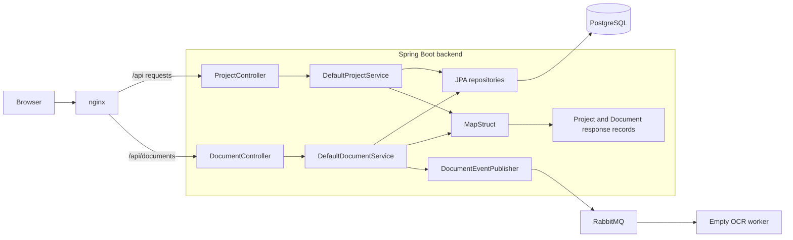

# SWEN3 Document Management System

Software Engineering 3 Labor, WS 2026, Group G
Yann Polini and Simon Stangelberger

[Repository](https://github.com/SimSta123/SWEN-3-Document-Management-System) | [Kanban board](https://github.com/users/YannPolini/projects/4) | [Milestones](https://github.com/SimSta123/SWEN-3-Document-Management-System/milestones)

This is our document management system for SWEN3. We can save document titles, list them on a dashboard and open their details. We can also post a PDF to the API, which sends a message to the worker. Our additional use case is organising documents into projects. Each document belongs to one project at a time, and assigning it to another project moves it there.

We use `sprint-3` for the current sprint and midterm review. It includes the earlier midterm work, PDF upload through REST, RabbitMQ and an empty OCR worker. `mid-term-code-review` is the older version. File storage, actual OCR and search come in Sprint 4.

## How our project works

We use HTML, CSS and JavaScript for the website, nginx for the web server, Java 25 with Spring Boot 4.1.1 for the backend, and PostgreSQL 17 for storage. We build the backend with Maven.



When we save a title or upload a PDF, the request goes through nginx to `DocumentController`. It calls `DocumentService`, implemented by `DefaultDocumentService`. The service validates and saves a `DocumentEntity`, then publishes a document-created message to RabbitMQ. MapStruct converts the entity into the `Document` record returned as JSON. Project creation and document assignment use `ProjectController` and `DefaultProjectService`.

The main parts are:

- We separate request handling, business logic and database access. The service interface lets us test business logic separately.
- We use Spring to inject the service, repositories, mapper and logger through constructors.
- Spring Data JPA handles the database access. Flyway creates the tables, and Hibernate checks that they match our entities.
- We use MapStruct to keep database entities separate from the records returned by the API.
- We use nginx to serve the website and forward API requests. It removes `/api/` before forwarding them to the backend.

The main code is in [controllers](backend/src/main/java/at/technikum/swen3/paperless/controller), [services](backend/src/main/java/at/technikum/swen3/paperless/service), [entities](backend/src/main/java/at/technikum/swen3/paperless/model), [repositories](backend/src/main/java/at/technikum/swen3/paperless/repository) and [migrations](backend/src/main/resources/db/migration).

## Run the project

You need Docker Desktop with Linux containers enabled.

1. Copy `.env.example` to `.env` and set `POSTGRES_PASSWORD` and `RABBITMQ_PASSWORD`.
2. From the project folder, run:

   ```sh
   docker compose up --build --detach --wait
   ```

3. Open [localhost](http://localhost/) for the website. The API uses [localhost:8081](http://localhost:8081) by default.

We can change the default ports with `WEB_PORT` and `API_PORT` in `.env`. PostgreSQL is only reachable inside Docker.

We stop the services with `docker compose down`, which keeps the database volume. We keep `.env` out of Git. Changing its password does not update an existing database volume.

## Website and API

Our [dashboard](frontend/public/index.html) groups documents by project, including Unassigned. We can add a title and open the [detail page](frontend/public/document.html) to see its title, ID and project. We show messages for empty lists, failed requests and missing documents.

We check titles in the website and validate requests in the API. The service checks inputs too, so these checks also apply when it is called directly. Blank names or titles, values over the length limits and invalid IDs are rejected. Missing records return 404. The request filter logs requests, and the service logs its operations and rejected inputs. Service DEBUG logging is enabled in [application.properties](backend/src/main/resources/application.properties).

Our [request examples](requests/projects.http) cover this flow. We use the returned IDs in later requests.

| Method | Endpoint | Action |
| --- | --- | --- |
| POST | `/projects` | Create a project |
| GET | `/projects` | List projects |
| POST | `/documents` | Create a document record from JSON, or accept a multipart PDF upload |
| GET | `/documents` | List all document records, including unassigned ones |
| GET | `/documents/{documentId}` | Read one document record, or return 404 |
| PUT | `/projects/{projectId}/documents/{documentId}` | Assign or move a document |
| GET | `/projects/{projectId}/documents` | List a project's documents |

Our [health requests](requests/health.http) check the backend and database connection.

### Post a PDF for Sprint 3

Send the PDF as a multipart `file` field. You can also set a `title`, otherwise we use the filename. Files can be up to 10 MiB. Empty files and files without a `%PDF-` header return 400. We only check the header, we do not parse the PDF yet.

```sh
curl --fail-with-body -F "file=@/path/to/notes.pdf;type=application/pdf" -F "title=Course notes" http://localhost/api/documents
docker compose logs --since 1m ocr-worker
```

On Windows use `curl.exe` and replace the file path with your PDF's path. You can also call the backend directly at `http://localhost:8081/documents`, using your `API_PORT` if you changed it. The response should be 201 with the new document ID. Look for `Received upload for OCR: Document created: <id>` in the worker logs. The website still uses the title form.

For now, we check the uploaded PDF but only save its title. The file is discarded after the request. RabbitMQ gets the document ID in a text message. Saving the actual file and running OCR come in Sprint 4.

## Failure handling

The service uses `InvalidInputException` for invalid values and `NotFoundException` for missing records. [ApiExceptionHandler](backend/src/main/java/at/technikum/swen3/paperless/controller/ApiExceptionHandler.java) turns these into 400 and 404 responses. It also handles invalid JSON and invalid request parameters. Errors use a JSON problem response with a status and detail.

Database conflicts return 409, unavailable connections and temporary database failures return 503, and other failures return 500. The full error goes in the logs. The API returns a short message without SQL or connection details.

## OCR worker

The [worker](ocr-worker/src/main/java/at/technikum/swen3/worker/UploadListener.java) runs in its own container. It receives upload messages from RabbitMQ and logs them. It does not read PDFs or run OCR yet.

We use a durable queue called `document.uploaded`. Set `OCR_QUEUE` to change it. The worker declares the queue when it connects. Spring acknowledges each message after the listener returns. Blank messages and invalid UTF-8 are rejected with `InvalidUploadMessageException`. Rejected messages go to the durable `document.uploaded.failed` queue. Other listener failures go there too, so a bad message does not get retried forever. The failed queue has no consumer. We can inspect it in RabbitMQ. Spring reconnects the listener if the broker goes offline.

The backend sends `Document created: <id>` through the default exchange (`""`), using the queue name as the routing key. The worker just logs the message. The queue uses `x-dead-letter-exchange=""` and `x-dead-letter-routing-key="document.uploaded.failed"`. With another `OCR_QUEUE`, the failed queue is that name plus `.failed`.

If you have an older queue without these failed-message settings, RabbitMQ will reject the changed arguments. Use a new `OCR_QUEUE` for testing, or drain the old queue before recreating it. Do not delete queued uploads.

Run `docker compose logs -f ocr-worker` to see received messages. RabbitMQ's management page is at [localhost:15672](http://localhost:15672/), with user `paperless` and the password from `.env`.

The listener follows the [Spring AMQP example](https://docs.spring.io/spring-amqp/reference/amqp/receiving-messages/async-annotation-driven.html) and [exception handling docs](https://docs.spring.io/spring-amqp/reference/amqp/exception-handling.html). We used Codex to help with the worker, failure handling and checks.

## Tests

We use JUnit and Mockito with mocked repositories and mapping to test valid/invalid inputs, length limits, missing records and assignment. These tests do not use our PostgreSQL database.

Our Spring Boot tests use real HTTP requests and an H2 database. They cover startup, health, document creation, reads and PDF uploads. RabbitMQ is mocked in these tests. We check the running app separately with PostgreSQL and RabbitMQ.

The Docker build runs our tests. With JDK 25 installed, we can also run `./mvnw verify` from `backend/`, or `.\mvnw.cmd verify` on Windows. JaCoCo writes the coverage report to `backend/target/site/jacoco/index.html`.

On 1 November 2026, all 66 backend tests and 7 worker tests passed. Backend coverage was 93.27% for lines and 93.10% for branches. These figures include unit and HTTP integration tests.

Our [CI workflow](.github/workflows/ci.yml) runs the backend tests and starts the Compose stack. The worker build runs its own unit tests. [The worker check](scripts/check-ocr-worker.py) sends text and JSON messages, checks the logs and acknowledgements, and checks that blank or invalid UTF-8 messages go to the failed queue.

To run the worker check locally, set `RABBITMQ_PASSWORD` in your shell to match the stack and run `python scripts/check-ocr-worker.py`. It uses `OCR_QUEUE` if set. Use a separate test stack because the script reads messages from the failed queue. For the full PDF-to-worker check, use the upload and log commands above.

## Our work and lessons learned

We started with the API and project grouping, then added the website, validation, logging and tests. Sprint 3 adds RabbitMQ, the empty worker and the PDF endpoint. Our tasks are on the board linked at the top.

One thing we ran into was nginx forwarding the wrong path. Removing `/api/` fixed that. We also had to put validation in the service, since frontend and API validation do not cover direct service calls. For test coverage we check the JaCoCo report as well as the test results.

We work on sprint branches and merge into `main` after checking the whole app. Previous merges are in the [pull requests](https://github.com/SimSta123/SWEN-3-Document-Management-System/pulls?q=is%3Apr+is%3Amerged). We both go through the code before the review.
