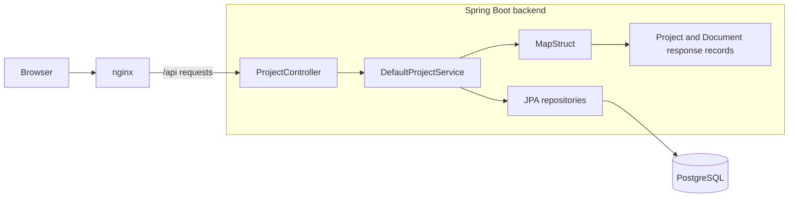

# SWEN3 Document Management System

Software Engineering 3 Labor, WS 2026, Group G
Yann Polini and Simon Stangelberger

[Repository](https://github.com/SimSta123/SWEN-3-Document-Management-System) | [Kanban board](https://github.com/users/YannPolini/projects/4) | [Milestones](https://github.com/SimSta123/SWEN-3-Document-Management-System/milestones)

We are building a document management system as our semester project. We currently save document titles, list them on a dashboard and show their details. Our additional use case is organising documents into projects. A document can belong to one project at a time, and assigning it to another project moves it there.

We now use `sprint-3` for Sprint 3 and the midterm review. It includes the earlier midterm work, RabbitMQ and an empty OCR worker. We keep `mid-term-code-review` as the old midterm version. PDF upload and queue publication are still being added. Actual OCR and search come in Sprint 4.

## How our project works

We use HTML, CSS and JavaScript for the website, nginx for the web server, Java 25 with Spring Boot 4.1.1 for the backend, and PostgreSQL 17 for storage. We build the backend with Maven.



When we save a title, the request goes through nginx to `ProjectController`. It calls `ProjectService`, implemented by `DefaultProjectService`. The service validates and saves a `DocumentEntity`. MapStruct converts it into the `Document` record returned as JSON.

We made these choices:

- We separate request handling, business logic and database access. The service interface lets us test business logic separately.
- We use Spring to inject the service, repositories, mapper and logger through constructors.
- We use Spring Data JPA for persistence. Flyway creates the schema, and Hibernate checks it against our entities.
- We use MapStruct to keep database entities separate from the records returned by the API.
- We use nginx to serve the website and forward API requests. It removes `/api/` before forwarding them to the backend.

The main code is in [controllers](backend/src/main/java/at/technikum/swen3/paperless/controller), [services](backend/src/main/java/at/technikum/swen3/paperless/service), [entities](backend/src/main/java/at/technikum/swen3/paperless/model), [repositories](backend/src/main/java/at/technikum/swen3/paperless/repository) and [migrations](backend/src/main/resources/db/migration).

## Run the project

You need Docker Desktop with Linux containers enabled.

1. Copy `.env.example` to `.env` and set `POSTGRES_PASSWORD` and `RABBITMQ_PASSWORD`.
2. From the project folder, run:

   ```sh
   docker compose up --build --detach --wait
   ```

3. Open [localhost](http://localhost/) for the website. The API uses [localhost:8081](http://localhost:8081) by default.

We can change the default ports with `WEB_PORT` and `API_PORT` in `.env`. PostgreSQL is only reachable inside Docker.

We stop the services with `docker compose down`, which keeps the database volume. We keep `.env` out of Git. Changing its password does not update an existing database volume.

## Website and API

Our [dashboard](frontend/public/index.html) groups documents by project, including Unassigned. We can add a title and open the [detail page](frontend/public/document.html) to see its title, ID and project. We show messages for empty lists, failed requests and missing documents.

We validate document titles in the website, validate REST request fields and check inputs again in the business service. We reject blank names/titles, values above our length limits and invalid IDs. Missing records return 404. Our controller logs requests, and the service logs operations and rejected inputs. We enable service DEBUG logs in [application.properties](backend/src/main/resources/application.properties).

Our [request examples](requests/projects.http) cover this flow. We use the returned IDs in later requests.

| Method | Endpoint | Action |
| --- | --- | --- |
| POST | `/projects` | Create a project |
| GET | `/projects` | List projects |
| POST | `/documents` | Create a document record |
| GET | `/documents` | List all document records, including unassigned ones |
| GET | `/documents/{documentId}` | Read one document record, or return 404 |
| PUT | `/projects/{projectId}/documents/{documentId}` | Assign or move a document |
| GET | `/projects/{projectId}/documents` | List a project's documents |

Our [health requests](requests/health.http) check the backend and database connection.

## Failure handling

The service uses `InvalidInputException` for invalid values and `NotFoundException` for missing records. [ApiExceptionHandler](backend/src/main/java/at/technikum/swen3/paperless/controller/ApiExceptionHandler.java) turns these into 400 and 404 responses. It also handles invalid JSON and invalid request parameters. Errors use a JSON problem response with a status and detail.

We use Spring Data's exceptions for database failures. Data conflicts return 409, unavailable connections and temporary database failures return 503, and other failures return 500. Internal details stay in the logs. The API returns a short message without SQL or connection details.

## OCR worker

The [worker](ocr-worker/src/main/java/at/technikum/swen3/worker/UploadListener.java) runs in its own container. It receives upload messages from RabbitMQ and logs them. It does not read PDFs or run OCR yet.

We use a durable queue called `document.uploaded`. Set `OCR_QUEUE` to change it. The worker declares the queue when it connects. Spring acknowledges each message after the listener returns. Blank messages and invalid UTF-8 are rejected with `InvalidUploadMessageException`. Rejected messages go to the durable `document.uploaded.failed` queue. Other listener failures go there too, so a bad message does not get retried forever. The failed queue has no consumer. We can inspect it in RabbitMQ. Spring reconnects the listener if the broker goes offline.

For #27, the backend can publish to the default exchange (`""`) with the queue name as the routing key. Send a UTF-8 text or JSON message, for example `{"documentId":42}`. The worker logs the body without parsing it, so this example does not fix the final upload message format. Do not send the PDF bytes in this message. If the backend also declares the queue, use the same durable setting and arguments: `x-dead-letter-exchange=""` and `x-dead-letter-routing-key="document.uploaded.failed"`. With another `OCR_QUEUE`, the failed queue is that name plus `.failed`.

The earlier #28 queue had no failed-message settings. RabbitMQ cannot change queue arguments in place. If that queue already exists, use a new `OCR_QUEUE` for testing or drain it before recreating it with these settings. Do not delete queued uploads.

Run `docker compose logs -f ocr-worker` to see received messages. RabbitMQ's management page is at [localhost:15672](http://localhost:15672/), with user `paperless` and the password from `.env`.

The listener follows the [Spring AMQP example](https://docs.spring.io/spring-amqp/reference/amqp/receiving-messages/async-annotation-driven.html) and [exception handling docs](https://docs.spring.io/spring-amqp/reference/amqp/exception-handling.html). We used Codex to help with the worker, failure handling and checks.

## Tests

We use JUnit and Mockito with mocked repositories and mapping to test valid/invalid inputs, length limits, missing records and assignment. These tests do not use our PostgreSQL database.

Our Spring Boot tests use HTTP and an H2 database to check startup, health, document creation and reads. We check the website separately in the browser. The earlier main checks covered saving, validation, lists, details and persistence after restarting the PostgreSQL stack.

The Docker build runs our tests. With JDK 25 installed, we can also run `./mvnw verify` from `backend/`, or `.\mvnw.cmd verify` on Windows. JaCoCo writes the coverage report to `backend/target/site/jacoco/index.html`.

On 18 October 2026, all 47 tests passed, with 83.33% line coverage and 95% branch coverage. This includes unit and integration tests. We rerun the checks after code changes.

Our [CI workflow](.github/workflows/ci.yml) runs backend tests and Compose checks. It also sends text and JSON messages to RabbitMQ, checks the worker logs and acknowledgements, and checks that blank and invalid UTF-8 messages reach the failed queue with [this script](scripts/check-ocr-worker.py). To run that check locally on a test stack, set `RABBITMQ_PASSWORD` in your shell to match the stack and run `python scripts/check-ocr-worker.py`. The script uses `OCR_QUEUE` if set and reads messages from the failed queue, so use a separate test stack. The worker build also runs its unit tests. This checks the worker directly. The PDF upload check still needs #27, including handling publication failures in that new code.

## Our work and lessons learned

We built the project grouping, website and REST endpoints, then added backend tests, logging and business-layer validation. We track our work on the board. The midterm tasks are [validation #33](https://github.com/SimSta123/SWEN-3-Document-Management-System/issues/33), [logging #34](https://github.com/SimSta123/SWEN-3-Document-Management-System/issues/34), [tests #35](https://github.com/SimSta123/SWEN-3-Document-Management-System/issues/35), [documentation #36](https://github.com/SimSta123/SWEN-3-Document-Management-System/issues/36) and [final checks #37](https://github.com/SimSta123/SWEN-3-Document-Management-System/issues/37).

We learned that nginx has to remove `/api/`, or the backend receives the wrong path. We also found that frontend and REST validation do not protect direct service calls, so we added business-layer checks. A passing build does not prove enough coverage, so we check the JaCoCo report.

We use separate branches and keep `main` for the checked version. We assign tasks on the board, test our changes and check the whole app before merging. Previous merges are recorded in [pull requests](https://github.com/SimSta123/SWEN-3-Document-Management-System/pulls?q=is%3Apr+is%3Amerged). We both study the whole project for the review.
